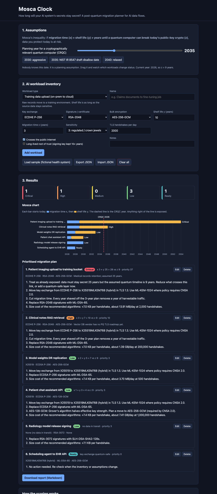

# Mosca Clock

A post-quantum migration planner for AI data flows. You list the places your AI system moves or signs data (training uploads, RAG retrieval, inference APIs, model signing), say what cryptography each one uses, and the tool tells you which flows are already exposed to "harvest now, decrypt later" and what to fix first.

Built by Manonmayi Vedam (DBA candidate) for the [Creators AI Winter Challenge](https://creators-ai-winter-challenge.devpost.com/). It grew out of my dissertation proposal, *Securing AI Workloads in the Age of Quantum Computing*.



## The idea in one formula

Mosca's inequality: if **x + y > z**, data you protect today is at risk.

| Symbol | Meaning | Where it comes from in the app |
|---|---|---|
| x | Years to migrate this flow to quantum-safe crypto | You enter it |
| y | Years the data must stay secret (shelf life) | You enter it |
| z | Years until a cryptographically relevant quantum computer (CRQC) | Slider: CRQC year minus the current year |

Key exchange (RSA, ECDH, X25519) can be recorded now and decrypted later, so it is scored on x + y vs z. Signatures (RSA, ECDSA, Ed25519) cannot be harvested; a forged signature only becomes possible once a CRQC exists, so they are scored on x vs z.

## Status rules

| Status | Rule |
|---|---|
| Critical | Key exchange vulnerable and y > z. Traffic sent today is already harvestable. |
| High | Key exchange vulnerable and x + y > z. |
| Medium | Within 2 years of failing, or signatures still classical when the CRQC arrives (x > z - 2). |
| Low | Vulnerable, but the timeline leaves room. |
| Ready | Everything recorded is quantum-safe. |

Priority = status weight (0 to 4) × sensitivity (1 to 3) × 1.5 if internet-facing, plus years of exposure.

The plan also shows the size cost of moving to the recommended algorithms (X25519MLKEM768 key exchange, ML-DSA-65 or SLH-DSA signatures), using byte sizes from FIPS 203, 204 and 205. For example, an X25519 + ECDSA P-256 handshake carries 192 bytes of key shares, public key and signature; X25519MLKEM768 + ML-DSA-65 carries 7,597.

## Features

- Seven AI workload templates with editable defaults, plus a custom type
- CRQC year slider with three presets (2030, 2035, 2040) for what-if analysis
- Mosca chart (SVG) showing x and y against the CRQC line for every workload
- Ranked migration plan with concrete actions per workload
- Handshake size overhead per workload and per day
- Markdown report download; JSON export and import
- Fictional sample inventory (`index.html#sample`, or `#sample&crqc=2030`)
- Runs entirely in the browser. Data is stored only in your browser's local storage. No server, no accounts, no API keys, no tracking.

## Run it

Browsers block ES modules from `file://`, so serve the folder:

```bash
cd mosca-clock
python3 -m http.server 8080 --bind 127.0.0.1
# open http://127.0.0.1:8080/#sample
```

Tests (Node 20 or later, no dependencies):

```bash
npm test
```

## Deploy to GitHub Pages

1. Push this folder to a public GitHub repository.
2. Settings > Pages > Source: "Deploy from a branch", branch `main`, folder `/ (root)`.
3. The app is then at `https://<your-username>.github.io/<repo>/#sample`.

## Project layout

```
index.html            page structure
src/scoring.js        Mosca model, algorithm catalogue, priority, overhead (no DOM)
src/templates.js      AI workload templates and the fictional sample
src/report.js         Markdown report builder
src/app.js            UI, chart, storage, import/export
src/styles.css        styles
test/scoring.test.js  17 unit tests (node:test)
docs/                 screenshots, demo video script
```

## Limits

- The CRQC year is an assumption. Nobody knows it. The 2035 preset is the year draft NIST IR 8547 (November 2024) proposes to disallow RSA and ECC, which is a policy date, not a forecast.
- x and y are user estimates. The tool is as good as those numbers.
- The model looks at one flow at a time. It does not trace data copied from one flow into another.
- Overhead counts key shares plus one certificate public key and signature. Real TLS chains carry more certificates; session resumption carries fewer.
- This is a planning aid, not a security assessment.

## Sources

- NIST FIPS 203 (ML-KEM), FIPS 204 (ML-DSA), FIPS 205 (SLH-DSA), August 2024
- NIST IR 8547 initial public draft, *Transition to Post-Quantum Cryptography Standards*, November 2024
- NSA CNSA 2.0 (AES-256 and ML-KEM-1024 for national security systems)
- M. Mosca, "Cybersecurity in an era with quantum computers: will we be ready?", IEEE Security & Privacy, 2018
- IETF draft-ietf-tls-ecdhe-mlkem (X25519MLKEM768 key share sizes)

## AI use and originality

The concept, the choice of Mosca's inequality as the model, the AI workload categories and the scoring rules come from my dissertation research. I used an AI coding assistant to write most of the code, tests and this README from my specification, then reviewed and tested the result. No third-party libraries or templates are used. Algorithm sizes come from the published standards listed above.

## License

MIT. See [LICENSE](LICENSE).
